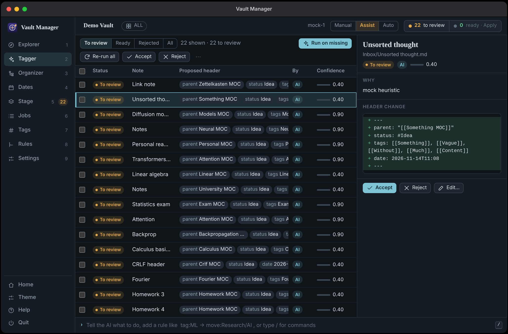
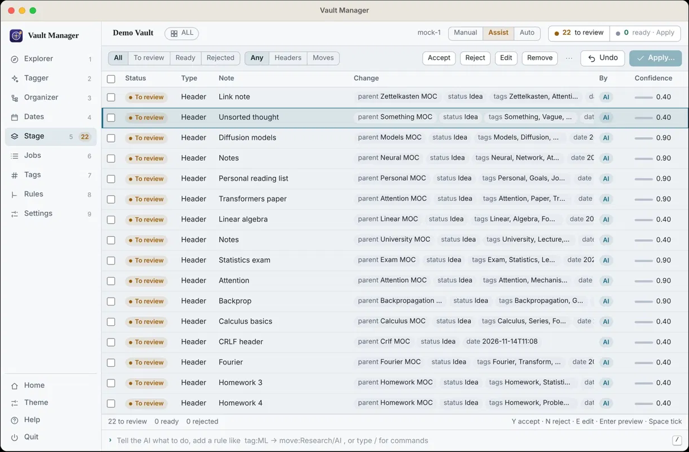

# Vault Manager

An LLM-assisted tagger and organizer for [Obsidian](https://obsidian.md) vaults. It adds missing note headers
(parent, status, tags, date), fixes broken dates, and proposes and applies a cleaner folder structure, using any
OpenAI-compatible model (local or hosted).


<p align="center"></p>
<p align="center"></p>

**Nothing touches your vault until you review and apply it. Every apply can be undone. Note bodies are never changed unless you edit one yourself.**

It comes in three flavours that share one engine:

| | What it is | How to get it |
|---|---|---|
| **Desktop app (GUI)** | A window with every feature. No Python needed. | Download a binary from [Releases](../../releases) |
| **Terminal UI (TUI)** | The same workspaces in your terminal | Install from source: `pip install -e ".[tui]"` |
| **Command line (CLI)** | Headless: scripts, cron, quick checks | Linux/macOS binaries (`vaultmgr cli`), or any OS from source (`vaultmgr-cli`) |

## Quick start

### Desktop app

1. Download the file for your system from [Releases](../../releases) (`vaultmgr-windows-*.exe`, `vaultmgr-linux-*`, `vaultmgr-macos-*.app.zip`) and run it.
   - **macOS:** the app is not signed. On the first launch, right-click it → **Open**, or run `xattr -dr com.apple.quarantine VaultMgr.app`.
   - **Windows:** if SmartScreen warns, choose **More info → Run anyway**.
   - **Linux:** make it executable first: `chmod +x vaultmgr-linux-*`.
2. On the Home screen choose your vault folder, or **Try the demo vault** to play with a messy sample vault and a fake model (no LLM needed).
3. Pick a workspace, then **Settings → Model** to add your LLM server and press **Test connection**.
4. In **Tagger**, press **Run on missing**. Review the proposals, accept the ones you like, then press **Apply** in **Stage**. Changed your mind? **Undo**.

The app opens in its own window and quits when you close the window (or press `Q`). From a terminal:

```
vaultmgr                              # open the app, pick a vault on the Home screen
vaultmgr /path/to/vault               # open straight into a vault
vaultmgr /path/to/vault --workflow dates     # straight into one workspace (all | header | organizer | dates)
vaultmgr --demo                       # sample vault + fake model
vaultmgr serve                        # no window: open the printed address in any browser
vaultmgr version
```

### Terminal UI

The TUI is not in the binaries; install it from source (Python 3.10+):

```
git clone https://github.com/KeyvanTajfar/Obsidian-Note-Manager.git
cd Obsidian-Note-Manager
pip install -e ".[tui]"

vaultmgr-tui /path/to/vault           # or:  vaultmgr tui /path/to/vault
vaultmgr-tui --demo
```

### Command line

On Linux and macOS the binary takes `vaultmgr cli ...`. The Windows `.exe` is a windowed app and cannot print into a terminal, so on Windows install from source and use `vaultmgr-cli ...`. The examples below use the `vaultmgr cli` form:

```
vaultmgr cli /path/to/vault status
vaultmgr cli /path/to/vault tag --route       # propose headers and folders
vaultmgr cli /path/to/vault stage             # list what is waiting
vaultmgr cli /path/to/vault accept --min-confidence 0.85
vaultmgr cli /path/to/vault apply --dry-run   # show what would change
vaultmgr cli /path/to/vault apply
vaultmgr cli /path/to/vault undo
vaultmgr cli /path/to/vault auto --route      # tag, route, accept confident, apply
vaultmgr cli /path/to/vault dates --fix       # offline date fixer, no model needed
```

## Workspaces

Each workspace is the same window showing only the tabs one job needs.

| Workspace | Tabs | Model used? |
|---|---|---|
| **ALL** | Explorer, Tagger, Organizer, Dates, Stage, Jobs, Tags, Rules, Settings | yes |
| **HEADER** | Explorer, Tagger, Dates, Stage, Jobs, Tags, Rules, Settings (no folder moves) | yes |
| **ORGANIZER** | Explorer, Organizer, Stage, Jobs, Rules, Settings (headers untouched) | yes |
| **DATE FIXER** | Explorer, Dates, Stage, Settings | **never**: offline, no API calls |

## Tabs

1. **Explorer**: browse the vault, edit headers by hand, move, rename, lock notes against the AI, tag a selection with the AI, edit a note's text.
2. **Tagger**: run the model over notes in parallel, watch proposals arrive, see a before/after diff, accept, reject or edit.
3. **Organizer**: the planned folder tree (editable, with descriptions), AI structure proposals, routing, and suggestions for new folders.
4. **Dates**: finds missing, unreadable, wrongly formatted and copy-time dates and fixes them from file timestamps.
5. **Stage**: every pending change in one place. Dry-run, apply, undo, and apply history.
6. **Jobs**: live progress, pause, resume, cancel, retry failures, change workers.
7. **Tags**: the value vocabulary with near-duplicate detection; rename, merge or remove across notes.
8. **Rules**: exact rules and free-text instructions for the AI.
9. **Settings**: model profiles, automation, safety, scanning, header fields, prompts.

Keys: `1`–`9` switch tabs, `/` or `:` focuses the command bar, `p` pauses jobs, `m` cycles the mode, `?` shows help, `q` quits.
In the command bar, `/run`, `/apply`, `/undo`, `/scan`, `/goto <tab>` and friends work as slash commands; plain text is a
free-text instruction to the AI (prefix `@folder:` or `#tag:` to scope it).

## Modes: auto never takes over

- **Manual**: the AI only runs when you ask.
- **Assist**: a watcher notices new or changed notes and proposes; you accept.
- **Auto**: confident proposals (≥ threshold) are accepted automatically, optionally applied up to a per-run cap.

You can pause, cancel, change workers, add an instruction or lock a note at any moment. Priority is always manual > rule > AI.

## Folder structure: plan, then freeze

The folder plan is yours to edit (add, rename, describe). Renames follow through to staged moves, rules and instructions.
Once it is right, **freeze** it: the AI then only routes into existing folders and *suggests* new nested ones for you to accept or ignore.

## Rules

```
tag:ML -> move:2_Research/AI
title~homework|assignment -> move:3_University/Homework
path:Daily/** -> skip
noheader text~"#recipe" -> set!:status=Reference move:Cooking
```

Conditions: `path folder name title text tag <header-key>`, `~` for regex, `!` negates, `noheader`, `hasheader`, `missing:KEY`.
Actions: `move`, `set` (fill if empty), `set!` (overwrite), `add` / `tag+`, `skip`, `lock`. Rules run before any model call.

## Configuration and where things are stored

- **Model**: any OpenAI-compatible endpoint (llama.cpp, vLLM, Ollama, LM Studio, OpenAI, OpenRouter, ...). A profile holds the base URL, model, key (or the name of an environment variable that holds it), extra request fields and JSON mode.
- **Header fields**: the defaults are `parent`, `status`, `tags`, `date`; fields, formats and per-field instructions are editable in Settings. Headers are edited by a byte-preserving line engine (not a YAML round-trip), so unusual existing headers like `status: #Idea` survive, and line endings and BOM are kept.
- **Prompts**, worker count, notes per request, thresholds, exclusions: all in Settings.

| What | Where |
|---|---|
| Model profiles, **API keys**, recent vaults | `profiles.json` in the config folder (owner-only permissions) |
| Crash log | `logs/vaultmgr.log` in the config folder |
| Per-vault settings, stage, undo journal, backups, rules | `<vault>/.vaultmgr/` (no secrets) |

The config folder is `~/.config/vaultmgr/` (Linux), `~/Library/Application Support/vaultmgr/` (macOS) or `%APPDATA%\vaultmgr\` (Windows); set `VAULTMGR_HOME` to change it.
To keep a key off disk, put the **name** of an environment variable in the profile instead of the key itself.

## Safety

Dry-run before every apply; journal and backups in `.vaultmgr/`; one-step undo (notes edited since are left alone and reported);
names are never overwritten on collision; modified times are preserved; links that a move would break are flagged;
empty folders are pruned only after moves.

## Troubleshooting the model

- **Settings → Model → Test connection** does a real chat and JSON request and reports what went wrong.
- **HTTP 401 "Missing Authentication header"**: the provider received no usable key. Listing models works without a key on some providers (OpenRouter), so a reachable server proves nothing. Test shows which key is sent (first 9 and last 4 characters). Pasted keys are cleaned of spaces, newlines, quotes and `Bearer `. A job that hits 401/402/403 pauses itself instead of failing every note.
- **"model returned an empty answer"**: a reasoning model (GLM, Qwen3, DeepSeek-R1, ...) used its budget on hidden thinking. The tool retries with a bigger budget; setting **Thinking** to `off` in the profile avoids the extra cost.
- **"did not return valid JSON"** shows what the model actually said. Try JSON mode `off`, or a model that follows instructions better.
- Coming from the old tool? `vaultmgr --import-config config.json` (or **Settings → Model → Import old config**) turns `ai_base_url`, `ai_model`, `ai_api_key` and `ai_timeout` into a profile.
- Something broke silently? Check the crash log (path in the Help dialog).

## Project layout

| Package | What it is |
|---|---|
| `src/vaultcore/` | Everything that does work, with no UI imports: scanning, header engine, LLM client, parallel jobs, stage, rules, taxonomy, apply/undo. The `Session` class is the single facade and emits events. |
| `src/vaultweb/` | The desktop app: a FastAPI server (JSON API + server-sent events), the window launcher, and the UI in `static/` (plain HTML, CSS and ES modules; no framework, no build step). |
| `src/vaulttui/` | The Textual terminal UI. Pure presentation over `Session`. |
| `packaging/` | PyInstaller build, app icon, smoke tests. |

The app opens its window with pywebview if installed (`pip install -e ".[native]"`), otherwise a Chromium/Chrome/Edge app-style window, otherwise a browser tab.

## Development

```
pip install -e ".[tui,dev]"
pytest                                     # core, API, desktop lifecycle and UI wiring tests
python packaging/ui_smoke.py               # optional: drives the real UI in headless Chromium (needs playwright)
```

The mock model (`--mock`, or the demo vault) makes tests and demos work with no server.

Build a binary yourself:

```
pip install -e ".[dev]" pyinstaller pillow
python packaging/build_binary.py           # -> dist/  (one file on Windows and Linux, a .app on macOS)
python packaging/smoke_test.py dist/<the binary>
```

Releases are built by CI: push a tag like `v0.9.0` (it must equal `vaultcore.__version__` and have a matching `CHANGELOG.md` section).

## Future work

- **Confidence from model weights.** Today "confidence" is the model's own self-reported number, which is uncalibrated. It should come from token log-probabilities of the generated header and route, calibrated against accepted and rejected history, so auto-accept thresholds mean something.
- **Fine-tuned model.** Train a small model on your accepted and rejected stage history for tagging and for that confidence signal.
- **Embedding-based routing** as a cheap pre-filter before the model.
- **Code signing** for the Windows and macOS builds.